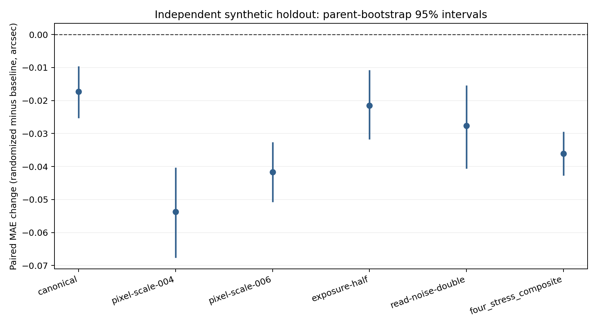
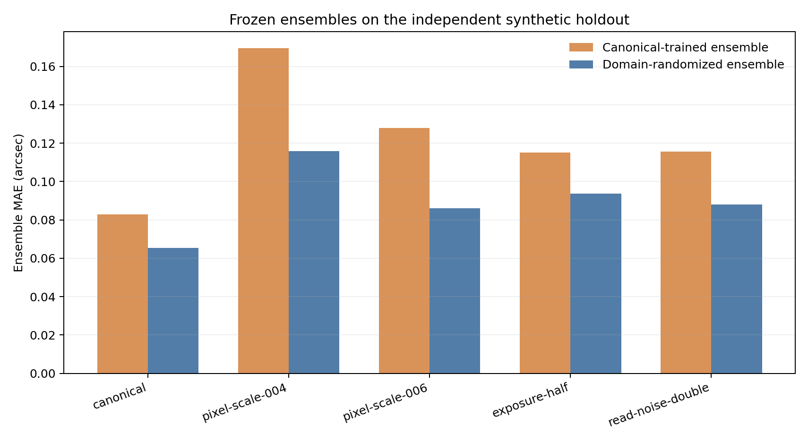

# Reliability of synthetic Einstein-radius regression under controlled observation mismatch

## Abstract

We evaluated a convolutional regressor for the Einstein radius, `theta_E`, using matched synthetic lens observations and a preregistered reliability study. Earlier development experiments found increased validation error at pixel scales 0.04 and 0.06 arcsec/pixel (+0.0707 and +0.0489 arcsec versus canonical), half exposure (+0.0463 arcsec), and doubled read noise (+0.0350 arcsec). Targeted domain-randomized training over those nuisance factors improved the fixed validation stress composite by -0.0290 arcsec. The final model was then frozen and compared with a canonical-trained ensemble on 150 new independent parent systems, each rendered under five conditions (750 observations total). The randomized ensemble's mean absolute error (MAE) was 0.0655 arcsec in the canonical condition and 0.0862–0.1158 arcsec across the four stress conditions. Its equal-weight parent-paired stress MAE change versus the canonical-trained ensemble was **-0.0361 arcsec** (10,000-resample parent-bootstrap 95% interval [-0.0427, -0.0294]). The study supports improved performance over the fixed comparator for these tested synthetic conditions. The holdout uses the same simulator and parent prior; a separate CASTLES comparison was descriptive and did not score real images. These results do not establish real-observation `theta_E` accuracy or close the simulation-to-real gap.

## Introduction

Learned parameter estimates can change when image scale, exposure, noise, source structure, and rendering assumptions shift. We studied one target, `theta_E`, with controlled matched-parent counterfactuals. The research question was whether measured synthetic failure modes could guide a bounded nuisance-randomization intervention and whether the resulting model retained its advantage on a new synthetic holdout. The study was designed to keep validation model selection, final holdout evaluation, cross-implementation checks, and real-domain descriptive evidence distinct.

## Methods

### Synthetic data and model

The core development release contains 1,000 simulated SIE systems partitioned by independent parent. The Week 8 training release contains 1,400 views from 700 training parents: each parent retains its canonical view and adds one view randomized over pixel scale (0.04/0.05/0.06 arcsec per pixel with matched native shapes 320/256/214), exposure multiplier (0.5/1.0), and read-noise multiplier (1.0/2.0). The final predictor is the arithmetic mean of three frozen CNN checkpoints (seeds 12001, 12002, 12003), each using its own training-only normalization. The original canonical-trained three-seed ensemble is a fixed comparator.

### Development perturbations and comparisons

Matched counterfactuals used 150 validation parents. The pixel-scale study compared 0.04 and 0.06 arcsec/pixel with canonical 0.05; the observation study included Gaussian PSF-width changes and observation-quality interventions; source-physics experiments varied Sersic profile/size, source position, and fixed external shear. Week 6 compared the CNN with train-mean, train-only Ridge, and an observation-only point-image geometry control, and evaluated image ablations and learning-curve subsets. The Week 7 alternate path independently implemented the SIE deflection/root/rasterization equations while sharing source-light rendering, PSF, detector noise, and preprocessing. Week 9 compared point-geometry fit initializations. These development results did not use the historical synthetic test split.

### Domain randomization and independent holdout

The Week 8 targeted-randomization decision used validation only. For final evaluation, protocol v1.11 and 117 input hashes were frozen before generation. A fresh seed 11031 produced 150 new parent systems and five matched conditions per parent: canonical, pixel scale 0.04, pixel scale 0.06, half exposure, and double read noise. Root and observation IDs and parameter/noise seeds were checked against development train/validation. The final split contains only `holdout` observations. Release products and manifests passed ancestry, identity, schema, strict-loader, and hash checks before inference.

Both frozen ensembles were evaluated once. Per-checkpoint and ensemble predictions were written to target-free files and hashed before `theta_E` was joined once for scoring. Parent-level paired effects average the four stress-condition error differences within parent for the composite. Confidence intervals use 10,000 bootstrap resamples of 150 independent parents, seed 6031. Descriptive error counts use fixed thresholds of 0.05 and 0.10 arcsec. No model selection or tuning followed holdout scoring.

### CASTLES observable-domain comparison

The Week 10 domain comparison included 137 processed CASTLES images from 69 lens systems and the 1,400-view synthetic training distribution. It measured available metadata and image proxies only. It did not read real `theta_E`/redshift labels or score model predictions.

## Results

### Development sensitivity and baselines

On matched synthetic validation parents, the frozen CNN's MAE increased by +0.0707 arcsec at pixel scale 0.04 and +0.0489 arcsec at 0.06. Half exposure increased MAE by +0.0463 arcsec and doubled read noise by +0.0350 arcsec. Tested Gaussian PSF-width changes were small or inconclusive. Source-position shifts produced increases up to +0.0248 arcsec for the tested x+0.15 arcsec condition; the fixed shear interventions were inconclusive. The observation-only S/N>=5 peak detector matched renderer multiplicity in 46.7–58.0% of Week 5 cases, so detected and physical image counts were not interchangeable.

The 700-parent learning-curve validation MAE was 0.0946 arcsec, compared with 0.1163 at 300 parents and 0.2039 at 100 parents. The train-only Ridge model improved on the train mean but underperformed the CNN on all seven reported conditions. The point-image geometry control had 44/150 fallbacks at canonical conditions and an all-parent MAE of 0.2007 arcsec. Masking the fixed 0.70–2.20 arcsec annulus increased MAE by +0.2632 arcsec (95% parent interval [+0.2246, +0.3022]); this indicates dependence on information in that image region, not an invalid causal shortcut.

### Independent equation-path comparison and mitigation

The Week 7 closed-form SIE deflection differed from Lenstronomy by at most 7.63e-9 arcsec on the tested grid; root counts agreed for 150/150 validation parents. The comparison shares important renderer components and is not evidence for general simulator independence. Week 8 domain-randomized training reduced the four-stress validation MAE by -0.0290 arcsec (95% parent interval [-0.0351, -0.0231]); canonical MAE changed by -0.0109 arcsec ([-0.0189, -0.0031]). Week 9 found no consistent optimizer-evaluation or runtime advantage for the CNN point-fit initializer; the result applies only to optimizer-eligible point-geometry cases.

### Independent synthetic holdout

The holdout contains 150 independent parents and 750 matched observations. Each condition has 150 parents. The final ensemble MAEs and paired changes versus the canonical-trained ensemble are:

| Condition | Baseline MAE | Randomized MAE | Paired MAE change | Parent-bootstrap 95% CI |
|---|---:|---:|---:|---:|
| Canonical | 0.0828 | 0.0655 | -0.0173 | [-0.0253, -0.0095] |
| Pixel scale 0.04 | 0.1696 | 0.1158 | -0.0537 | [-0.0677, -0.0403] |
| Pixel scale 0.06 | 0.1278 | 0.0862 | -0.0417 | [-0.0507, -0.0326] |
| Half exposure | 0.1150 | 0.0936 | -0.0215 | [-0.0318, -0.0108] |
| Double read noise | 0.1155 | 0.0879 | -0.0276 | [-0.0406, -0.0154] |
| Equal-weight four-stress composite | — | — | -0.0361 | [-0.0427, -0.0294] |

All five condition-specific paired error intervals and the four-stress composite interval are below zero. The randomized model had 73/150 canonical errors above 0.05 arcsec and 26/150 above 0.10 arcsec. Under pixel scale 0.04 those counts were 102/150 and 67/150, respectively. The full 750-case final-model catalog, comparator errors, seed spread, and available observation diagnostics are included with the package tables.

### CASTLES coverage

Of the processed CASTLES observations, 52.6% fell within the synthetic pixel-scale p01–p99 range. Only 6.6% fell within the synthetic processed-field-of-view range under the frozen coverage rule. These descriptive measurements have semantic limitations: intensity proxies use different calibration/normalization, radial features use cutout centers, and instrument-specific rendering, calibrated PSF/noise, masks, and reviewed multiplicity were not represented. No real-image prediction accuracy was estimated.

## Limitations

The independent holdout samples the same synthetic parent prior and renderer as development. Its nuisance conditions cover only the selected pixel-scale, exposure, and read-noise changes. Synthetic detector variance is not calibrated HST noise. The Week 7 comparison changes the mass-equation/root path while sharing Sersic light, PSF, noise, and preprocessing. The model predicts one scalar target and does not cover alternate mass families or a population-calibrated prior. The point-image baseline is not a full pixel-likelihood fit and has substantial fallbacks. The 137 CASTLES images were used only for observable metadata/proxy coverage; labels and model scores were not used. The three-seed ensemble spread is not a calibrated predictive interval. Accordingly, no real-observation accuracy, calibrated uncertainty, or simulator-to-real transfer claim is supported.

## Discussion

The study links measured synthetic sensitivity to a targeted training-distribution change and evaluates that change on new parents drawn from the same synthetic proposal. The randomized ensemble retained lower MAE than the fixed canonical-trained comparator on all five holdout conditions, including canonical. That is useful evidence for robustness within the tested simulator and nuisance range. Earlier development results also show why that result needs a narrow boundary: native pixel-scale and observation-quality changes raised error, source-position changes mattered for selected interventions, and a regional mask changed predictions substantially.

The Week 7 implementation agreement checks a limited equation/root/rasterization path. The Week 10 CASTLES audit, by contrast, identifies domain coverage gaps without scoring real lens parameters. Together they motivate a future blinded benchmark using calibrated image products, reviewed lens-center/multiplicity information, independently governed labels, and a specified evaluation split. Such a benchmark is needed before making claims about measured `theta_E` in astronomical observations.

## Conclusion

Targeted nuisance randomization improved paired `theta_E` MAE over a fixed canonical-trained ensemble on an independent synthetic holdout from the same prior and renderer. The experiments identify tested sensitivity mechanisms and show bounded mitigation, while the observable-domain audit leaves material simulation-to-real gaps unresolved. The evidence supports a reproducible synthetic reliability result, not real-image accuracy.

## Source artifacts

- Protocols and decisions: [study protocols](../), [Week 11 freeze](../week11_freeze_manifest.json)
- Week 3–10 phase reports: [pixel scale](../week3_pixel_scale_status.md), [observation systematics](../week4_observation_systematics_status.md), [source physics](../week5_source_physics_status.md), [baselines and shortcuts](../week6_baselines_shortcuts_status.md), [equation path](../week7_cross_simulator_status.md), [mitigation](../week8_mitigation_status.md), [hybrid initialization](../week9_hybrid_status.md), [CASTLES domain gap](../week10_domain_gap_status.md)
- Week 11 report and tables: [frozen holdout results](../../../results/reports/reliability_v1/blind_holdout_week11/report.md)
