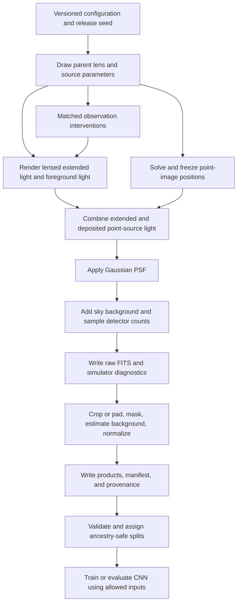

# Current gravitational-lens simulation pipeline

Documentation reviewed against the repository implementation on October 26,
2026. This describes the existing pipeline and recorded study; proposed
extensions are in [the archived cross-simulator plan](../archive/docs/cross_simulator_generalization_plan.md).
It does not change frozen experiments or report a new verification run.

## Purpose and scientific target

The pipeline creates controlled strong-gravitational-lens images for learning
and evaluating the scalar Einstein-radius parameter `theta_E_arcsec`. The
parameter is known because it is supplied to the simulated lens mass model.
For the main release it is the Lenstronomy singular isothermal ellipsoid
(SIE) parameter, expressed in arcseconds. It is not a physical mass, and its
convention must be checked before comparing with another renderer or a
published observational radius.

The research question is whether an image-based estimator remains accurate
when observation conditions change, and whether training on selected changes
reduces the measured errors. Simulations provide matched observations of the
same physical lens, so changes in prediction error can be measured while
holding the target fixed.

There are three distinct objects:

- A **parent system** contains the physical lens and source parameters.
- An **observation/view** renders that parent at a specified pixel scale,
  exposure, PSF, and noise state.
- A **release** contains observations, manifests, products, provenance, and
  where applicable ancestry-safe split assignments.

More views of a parent do not create more independent lens systems.

## Backend and software responsibilities

The simulation dependency is **`lenstronomy==1.14.2`**, pinned in
[`requirements.txt`](../requirements.txt). The project
does not simply use a ready-made telescope simulator: it combines Lenstronomy
components with repository-owned sampling, point-image painting, PSF
convolution, detector sampling, preprocessing, release validation, and
evaluation.

| Component | Implementation and responsibility |
|---|---|
| Parameter proposals | [`priors.py`](../src/simulation/priors.py): deterministic physical and observation draws. |
| Backend adapter | [`models.py`](../src/simulation/models.py): lazy imports, backend status, model constructors, parameter conventions. |
| Analytic and extended controls | [`render.py`](../src/simulation/render.py): SIS controls and extended-source rendering. |
| Observation formation | [`observation.py`](../src/simulation/observation.py): extended light, solved point images, Gaussian blurring, and detector noise. |
| Release generation | [`generate.py`](../src/simulation/generate.py): FITS/array/JSON products, manifests, diagnostics, and rejection logs. |
| Staged-release assembly | [`assemble.py`](../src/simulation/assemble.py): combines stage artifacts without renaming parents. |
| Engineering release | [`pipeline.py`](../src/pipeline.py), `build_engineering_release`: generation, splitting, validation, checksums, and audit mirror. |
| Matched interventions | [`counterfactual.py`](../src/simulation/counterfactual.py): parent-state rerenders, protected targets, ancestry checks, and canonical identity checks. |
| Processing | [`preprocess.py`](../src/processing/preprocess.py): FITS reading, crop/pad geometry, masks, background estimation, normalization, and fallback variance. |
| Data contract | [`dataset.py`](../src/data/dataset.py): strict product loading and separation of model inputs, targets, and provenance. |

Observation rendering sets `NUMBA_DISABLE_JIT=1` with `setdefault`; an existing
environment value is therefore not overridden. The release configuration
records the intended local reproducibility policy.

## Pipeline overview



## Coordinate and parameter conventions

Physical positions are `(x, y)` in arcseconds; image arrays are indexed
`image[y, x]`. Orientations are in radians, and `q` is minor/major axis ratio.
The backend adapter converts shape and orientation using:

```text
e  = (1 - q) / (1 + q)
e1 = e * cos(2 * phi)
e2 = e * sin(2 * phi)
```

The observation grid uses zero-based pixel centers, a diagonal pixel-to-angle
transform, and angular origin at the center of the array. For width `W`,
height `H`, and pixel scale `p`:

```text
x_arcsec = (x_pixel - (W - 1)/2) * p
y_arcsec = (y_pixel - (H - 1)/2) * p
```

The lens center may be offset from that origin. Descriptive geometry-sidecar
labels do not replace the explicit pixel-to-angle transform.

The canonical grid is 256 by 256 at 0.05 arcsec/pixel. Its nominal pixel-extent
field is 12.8 arcsec per side; its first-to-last pixel-center span is 12.75
arcsec. These definitions differ and should be stated when matching grids.

## Parent sampling and the meaning of standard conditions

The main release uses
[`simulation_engineering_v1.yaml`](../configs/simulation/engineering.yaml),
which retains the validated P60 proposal ranges. Scalar ranges below are
uniform draws; orientation angles are uniform on `[0, pi)`.

| Quantity | Main-release range or value |
|---|---|
| Mass profile | SIE, without the P100 shear extension |
| Einstein-radius parameter | 0.5 to 2.0 arcsec |
| Lens axis ratio | 0.5 to 0.95 |
| Lens-center x and y offsets | Each -0.2 to +0.2 arcsec |
| Source-center x and y positions | Each -0.35 to +0.35 arcsec |
| Source axis ratio | 0.4 to 1.0 |
| Source Sersic index | 0.5 to 4.0 |
| Source effective-radius parameter | 0.05 to 0.3 arcsec |
| Source amplitude | 0.5 to 2.0, renderer amplitude convention |
| Lens-light axis ratio | 0.5 to 1.0 |
| Lens-light Sersic index | 1.0 to 4.0 |
| Lens-light effective-radius parameter | 0.15 to 0.6 arcsec |
| Lens-light amplitude | 0.02 to 0.2, renderer amplitude convention |
| Unlensed point-source amplitude parameter | 0.2 to 1.0 |
| Gaussian PSF FWHM | 0.1 to 0.2 arcsec |
| Background rate | 0.01 to 0.05 in the synthetic detector-rate convention |
| Read-noise standard deviation | 1.0 to 3.0 electrons |
| Exposure | 80 to 120 seconds |
| Extended-light supersampling | Factor 2 |

**Standard/canonical does not mean every image has identical conditions.**
Parents already have independently sampled PSF widths, backgrounds, exposure
times, and read noise. A canonical view uses its parent's original draws.
For example, a half-exposure counterfactual halves that parent's sampled
exposure rather than assigning every parent one common exposure.

These are engineering priors, not a population-calibrated selection function.
Sersic amplitudes are not interchangeable with total flux or observed
magnitude without applying the renderer's profile and unit conventions.

For the SIE draw, parameter and noise seeds are derived through
`SeedSequence([release_seed, 3003, index])`. Observation draws use a generator
seeded from `parameter_seed + 17`; stress draws use `parameter_seed + 7001`.
Saved parameter/noise seeds and configuration hashes support reproducibility.

## Scene construction

### Extended source and foreground light

Lenstronomy renders a `SERSIC_ELLIPSE` background source through the SIE mass
model. A separate `SERSIC_ELLIPSE` describes foreground lens light and is
centered on the mass center. Extended light is evaluated with configured
supersampling. Shear-enabled stress or counterfactual scenes add `SHEAR`
using `gamma1` and `gamma2`.

The main scene also includes a point-source component at the source center.
Although configuration model summaries contain `UNLENSED`, the current
observation implementation solves point images through `SOURCE_POSITION`
when positions have not already been saved. The executable path in
`render_observation_scene` is authoritative for released observations.

### Point-image reproducibility

The generator first solves image positions, saves them rounded to eight
decimal places in arcseconds, then renders again using those saved positions.
For saved roots, amplitudes are recomputed from absolute magnification times
the source amplitude and rounded to three decimal places.

The project deposits point-image amplitudes bilinearly on the pixel grid
itself. This avoids backend point-painting differences across processes
changing pixels and subsequent Poisson draws. Positions outside the image
cause an explicit failure.

The saved `clean_scene` is extended-source plus foreground light **without
point sources or PSF convolution**. The expected detector scene includes the
deposited point sources and PSF convolution. They are different diagnostics.

### Telescope blurring

The repository constructs a unit-sum Gaussian PSF with:

```text
sigma_pixels = FWHM_arcsec / (2 * sqrt(2 * ln(2)) * pixel_scale_arcsec)
kernel side = odd ceil(10 * sigma_pixels), minimum 5 pixels
```

It applies deterministic same-sized convolution with zero-valued boundaries
to the combined extended and point light. The kernel array and metadata are
saved. This is an analytic control PSF, not an empirical Hubble PSF or a
complete instrument model.

## Detector sampling and units

`realize_detector_observation` treats the blurred scene `S` as a synthetic
electron rate per pixel. For scalar background `b`, exposure `t`, and read-noise
standard deviation `r`:

```text
lambda = t * (max(S, 0) + b)
P ~ Poisson(lambda)
R ~ Normal(0, r^2)                 independently per pixel
observed_electrons = P + R
observed_rate = observed_electrons / t
science_rate = observed_rate - b
expected_variance_rate = (lambda + r^2) / t^2
```

Sampling occurs before background subtraction. Background-subtracted science
pixels may be negative, which is compatible with this noise model. Arrays
returned as saved detector products use float32.

The raw FITS stores `observed_rate`, including background. The saved
`observed_science` diagnostic subtracts the known injected background.
The preprocessing science image instead subtracts an estimated background;
these products need not be numerically identical.

Noise draws use the saved noise seed. Using the same seed in an intervention
does not generally give identical sampled noise if Poisson means or image
shapes change. Repeated-noise interventions can derive a new seed from the
canonical noise seed and a declared offset.

## Preprocessing and the two variance products

The shared processing function:

1. Reads a two-dimensional science FITS image.
2. Replaces non-finite array values while retaining an invalid-pixel mask.
3. Center-crops or pads to the requested output shape and records the geometry.
4. Builds invalid and missing-coverage masks.
5. Estimates a scalar background with iterative sigma clipping.
6. Subtracts that estimate when valid; otherwise retains the standardized image.
7. Applies the configured image normalization and estimates fallback variance.

Source/outlier pixels excluded from background estimation remain valid
science pixels. Boolean masks use true for exclusion; the coverage mask
identifies missing/padded coverage.

The engineering simulation configuration uses `normalization_method: none`.
Thus the directory name `normalized/` does not imply percentile scaling.
The CNN subsequently applies global image and target standardization using
training-only statistics from its own checkpoint's training release.

Two different variance arrays are retained:

| Product | Meaning |
|---|---|
| `variance_path` | Shared preprocessing's toy scalar-background variance estimate. |
| `expected_variance_path` | Simulator expectation `(lambda + r^2)/t^2`, using known generating quantities. |

The simulator variance is useful for synthetic validation, but is not a
measured HST uncertainty map. The image-only baseline does not take it as an
input channel. General loader access does not authorize using privileged
simulator diagnostics as deployment inputs.

## Staged controls and the main engineering release

The pilot progression adds complexity in separate increments:

| Cumulative stage | Increment | Role |
|---|---:|---|
| P10 | 10 analytic SIS point-source controls | Check analytic geometry and noiseless behavior. |
| P30 | 20 SIE extended-source systems | Check elliptical lensing and smooth source rendering. |
| P60 | 30 observation scenes | Add lens light, point images, Gaussian PSF, and detector noise. |
| P100 | 40 stress systems | Broader morphology/observation ranges and SIE plus shear. |

The stage names are cumulative counts; an individual increment directory is
not necessarily a cumulative release. `assemble.py` can combine increments.
P100 is a separate stress suite and is not mixed into main training.

`sim-eng1000-v1` separately generates 1,000 independent P60-style parents with
seed 11001. It is not merely the pilot images duplicated to reach 1,000.
Ancestry splitting uses seed 4201 and produces 700 training, 150 validation,
and 150 historical test parents.

## Saved release products and provenance

Observation release paths are relative to the release root, with the manifest
as the index. Typical product groups are:

| Group | Contents |
|---|---|
| `raw/` | FITS images in synthetic electrons/second, including background. |
| `science/`, `normalized/` | Processed science arrays and configured model-image products. |
| `masks/` | Invalid, coverage, and background-estimation exclusion masks. |
| `variance/`, `expected_variance/` | Distinct preprocessing and simulator variance arrays. |
| `scenes/` | Clean extended light, blurred expected total scene, and known-background-subtracted observation. |
| `psf/` | Gaussian kernels and associated metadata. |
| `geometry/`, `background/`, `transforms/`, `noise/` | Geometry, estimated background, normalization, and generating-noise records. |
| `parameters/`, `diagnostics/` | Privileged truth, solved roots, amplitudes, multiplicity, and scene summaries. |
| Release-level records | `manifest.csv`, run manifest, rejection log, split reports, engineering report, and checksums where applicable. |

The exact schema is defined in [dataset_schema.md](dataset_schema.md).
Review previews live under `results/previews/simulated/<release>/` and are not
model inputs. Large arrays, raw files, and checkpoints are generally ignored
by Git. Compact engineering audit records are mirrored under
`data/manifests/sim-eng1000-v1/`.

## Validation, selection, and independence

The engineering-release builder requires requested counts to be accepted
without rejections, unique parent/sample IDs and seeds, simulation validation,
ancestry split validation, and strict loader acceptance. Product checks cover
schema, geometry, finite values, variance, PSF behavior, and deterministic
rerendering. Rejected render/write attempts are recorded rather than silently
discarded. See [the engineering release specification](production_dataset_v1.md).

Related parents, source templates, backgrounds, and descendants are grouped
through connected ancestry. They cannot cross train/validation/test boundaries.
Loader APIs distinguish allowed observation inputs, requested targets, and
privileged provenance. The studied CNN consumes an image only.

Multiplicity diagnostics also need distinct interpretations: physical solved
point roots, renderer amplitude-threshold counts, and observation-only detected
peaks are not interchangeable. The generating amplitude threshold is not a
measured signal-to-noise detection criterion.

## Matched counterfactual observations

`counterfactual.py` copies saved canonical state and applies allowlisted
interventions while protecting the primary target and identity fields.
All descendants inherit their parent's split. Changes to source position or
shear invalidate saved point roots so they can be solved again. Canonical
rerenders are checked against saved expected, observed, and processed products.

The reliability study covers scale, PSF width, exposure, read noise, repeated
noise, lens light, normalization, source Sersic parameters/positions, and fixed
shear interventions. It has not validated arbitrary mass or source families.

Scale interventions change both pixel scale and native array shape:

| Scale | Native shape |
|---|---|
| 0.04 arcsec/pixel | 320 by 320 |
| 0.05 arcsec/pixel | 256 by 256 |
| 0.06 arcsec/pixel | 214 by 214 |

The shapes approximately preserve angular field span; this is rerendering at
different sampling, not just resizing the original array. Counterfactual
preprocessing retains the declared shape. Shape-bucketed training and the
CNN's adaptive pooling support these variable-sized views; not every image
in the reliability study is forced to 256 by 256.

## Targeted training randomization

[`reliability_mitigation_v1.yaml`](../configs/reliability/mitigation.yaml)
adds one deterministic randomized view to each of the 700 training parents,
retaining the original view. Assignment uses PCG64 seed 6031 and samples:

- Pixel scale from 0.04, 0.05, and 0.06 arcsec/pixel, with the shapes above.
- Exposure multiplier from 0.5 and 1.0.
- Read-noise multiplier from 1.0 and 2.0.

The new view can combine nuisance changes; it is not an exhaustive factorial
rendering for each parent. There are 1,400 training views but still 700
independent systems. The same CNN architecture is fitted with three seeds
12001, 12002, and 12003. Each fit has its own training-only normalization;
the final prediction is their arithmetic mean in physical target units.

The fixed comparator is the original canonical-trained three-seed ensemble.
The comparison changes training data and potentially optimizer-update count
per epoch. It does not by itself isolate diversity from additional training
work; a matched-update control is a proposed extension.

## Final evaluation and established result

The historical test split was already opened for the initial baseline and was
quarantined from later study selection. The final study froze its models and
protocol before generating 150 new parents with seed 11031, using the same
engineering proposal. Each parent has canonical, scale 0.04, scale 0.06,
half-exposure, and doubled-read-noise views: 750 observations in total.

Both ensembles were evaluated once, with predictions saved and hashed before
target joins. The four-stress average MAE fell from about 0.1320 to 0.0959
arcsec, a 27.4% relative reduction against the project's own fixed baseline.
The parent-paired change was -0.0361 arcsec, with 95% parent-bootstrap interval
[-0.0427, -0.0294]. This is not a comparison against an external paper.

Parents are unseen; the simulator, physical proposal, and selected condition
values are familiar. This is not evidence of generalization to arbitrary
unseen instruments or simulators. See [the manuscript](reliability_study/final/manuscript_draft.md).

The Week 11 holdout has an exactly-once inference/scoring record. Do not
rerun it or overwrite its products to illustrate this document. Existing
tables and figures are available in `results/reports/final_v1/`.

## Existing alternate implementation and real-image boundary

The Week 7 implementation independently codes SIE/SIS deflection, point-root
search, and rasterization. It still shares Lenstronomy's Sersic light evaluator
and the project's PSF, detector, and processing stages. Its close agreement
checks conventions and implementation, not transfer to an independent full
simulation stack. See [the archived recorded comparison](../archive/docs/reliability_study/week7_cross_simulator_status.md).

CASTLES images are maintained separately. The completed study compared
observable properties for 137 images of 69 systems; it did not score real
Einstein-radius predictions. The current synthetic pipeline omits empirical
PSFs, instrument/filter-specific calibration, realistic irregular source
populations, correlated detector/resampling noise, and calibrated population
selection. Seed-ensemble spread is not a calibrated predictive interval.

## Safe entry points for a new development release

Run from the repository root with the simulation dependencies installed.
Use fresh release/output names; these examples must not overwrite frozen data.

```powershell
python -m src.pipeline simulate --stage observation --output data/simulations/sim-doc-example-v1 --simulation-id sim-doc-example-v1 --count 10 --seed 61001 --config configs/simulation/engineering.yaml --no-preview
python -m src.pipeline validate data/simulations/sim-doc-example-v1/manifest.csv --root data/simulations/sim-doc-example-v1
python -m src.pipeline make-splits data/simulations/sim-doc-example-v1/manifest.csv --output data/simulations/sim-doc-example-v1/splits --ancestry
```

A ten-parent release is a wiring example, not a statistical benchmark.
New scientific experiments require separately versioned settings and records.
The [study guide](reliability_study/README.md) indexes the original frozen
protocols; [CONTRIBUTING.md](../CONTRIBUTING.md) explains preservation rules.
