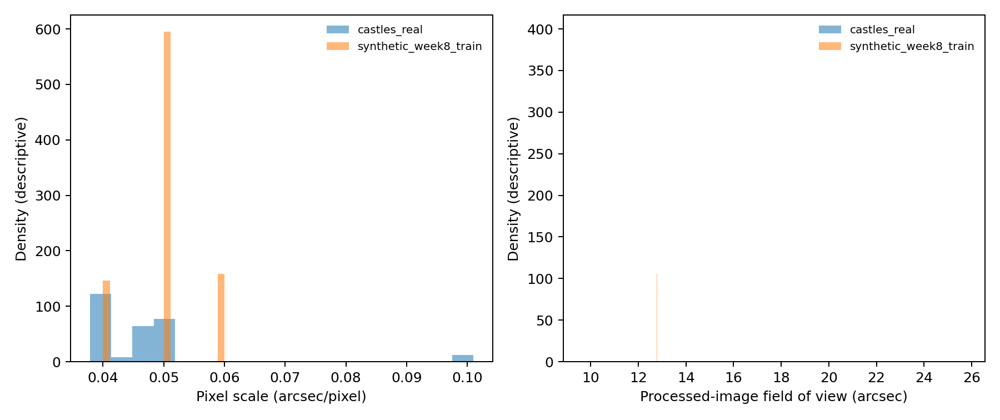
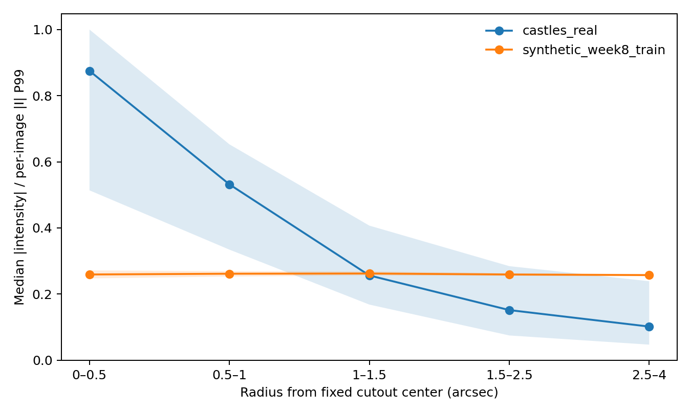

# Week 10 — CASTLES/synthetic domain gap

Compared **1400** Week 8 training views from **700** independent parents with **137** CASTLES images from **69** lens systems.
The analysis uses metadata and image proxies only. It does not score Einstein radii or model predictions on real images.

## Metadata coverage

- Telescope: HST: 120, <missing>: 17
- Instrument: NICMOS: 63, ACS: 37, WFPC2: 37
- Filter: <missing>: 74, F160W: 62, F205W: 1
- Detector: <missing>: 63, WFC: 37, 1: 31, 3: 3, 4: 2, 2: 1
- Calibration stage: <missing>: 74, UNCALIBRATED: 63
- Missing categories remain explicit in `metadata_category_counts.csv`; repeated images are grouped by lens in the row-level data.

## Frozen coverage map

| Feature | Rating | Real within synthetic P01–P99 | Limitation |
|---|---|---:|---|
| pixel_scale_arcsec | weakly represented | 0.526 | Same WCS-derived angular scale in both domains; synthetic pixel scale was randomized over three levels. |
| processed_field_of_view_x_arcsec | unsupported | 0.066 | Processed-image center-to-center width times pixel scale; this represents the angular field in the retained model input. |
| processed_field_of_view_y_arcsec | unsupported | 0.066 | Processed-image center-to-center height times pixel scale; this represents the angular field in the retained model input. |
| intensity_robust_range_q99_q01 | weakly represented | 0.000 | Image products use different calibration and normalization semantics; range is descriptive only. |
| central_concentration_abs_r05_over_r25 | weakly represented | 0.109 | Scale-free image proxy about the fixed cutout center; not lens-centered or a physical morphology label. |
| instrument_filter | unsupported | unavailable | CASTLES instrument/filter categories are measured, but the simulator has no instrument- or filter-specific rendering. |
| psf_family_and_calibrated_width | unsupported | unavailable | Synthetic PSFs are analytic Gaussian controls; eligible real PSF products/proxies are absent. |
| invalid_and_coverage_masks | unsupported | unavailable | Real normalized products have no retained invalid-pixel or coverage masks. |
| calibrated_detector_background_and_noise | unsupported | unavailable | Synthetic variance/read-noise settings are toy controls and cannot calibrate HST detector noise. |
| reviewed_image_multiplicity | unsupported | unavailable | No reviewed multiplicity field is available in the eligible real metadata release. |
| source_and_lens_morphology_family | weakly represented | unavailable | The simulator covers analytic Sersic plus point-source light and SIE mass with optional shear; realistic diversity is not established by radial proxies. |

Intensity ranges are shown only as within-product descriptive values: CASTLES products are percentile normalized, while synthetic products follow the simulation processing path. The outer-region proxy is not detector-background calibration. Neither the synthetic variance model nor read-noise parameter is treated as calibrated HST noise.

The existing [three-system astrometric comparison](../real-comparison-v1/comparison.md) is exploratory context only, not a general accuracy benchmark.

## Requirements for a future blinded real benchmark

1. Define eligibility from reviewed image quality and publish a lens-system-level split before model scoring.
2. Obtain independent, uncertainty-qualified Einstein-radius references and document model/decomposition provenance; do not treat a single heterogeneous catalog value as exact truth.
3. Preserve raw calibrated science, variance, bad-pixel/coverage masks, PSF products, filter/instrument metadata, exposure, and full crop/normalization provenance.
4. Calibrate simulator source/lens morphology, mass-profile, PSF, detector/background/noise, pixel scale, and selection distributions against those products.
5. Freeze checkpoints, preprocessing, eligible lens IDs, metrics, and scorer before predictions. Save and hash predictions before a separate custodian joins labels once.
6. Report system-level paired uncertainty and label/reference uncertainty; keep a separate blind test set unavailable during all model development.

## Limitations

- CASTLES intensity products and synthetic images have different calibration/normalization semantics.
- The 137 CASTLES rows are repeated images from 69 lens systems; distribution summaries are descriptive and lens clustered.
- No retained CASTLES invalid/coverage masks, eligible PSF products, or reviewed multiplicity labels were available.
- Outer-region brightness is a relative image proxy, not calibrated detector background or noise.
- Radial proxies use the fixed cutout center, not a fitted or truth lens center.
- No real-data model predictions or Einstein-radius/redshift labels were used.
