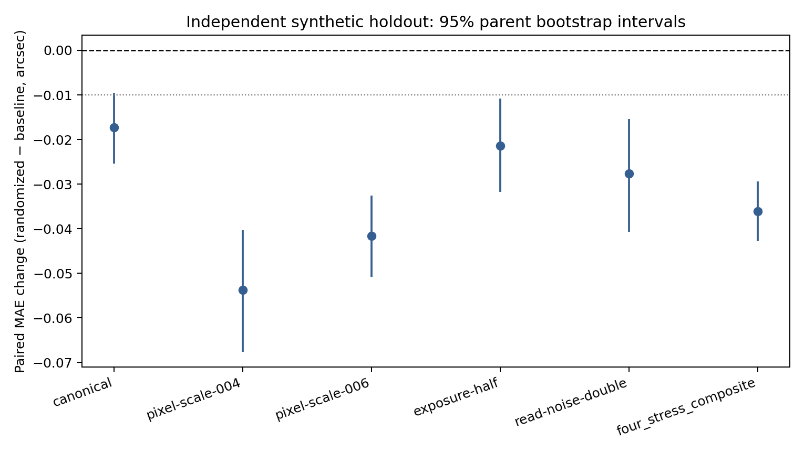
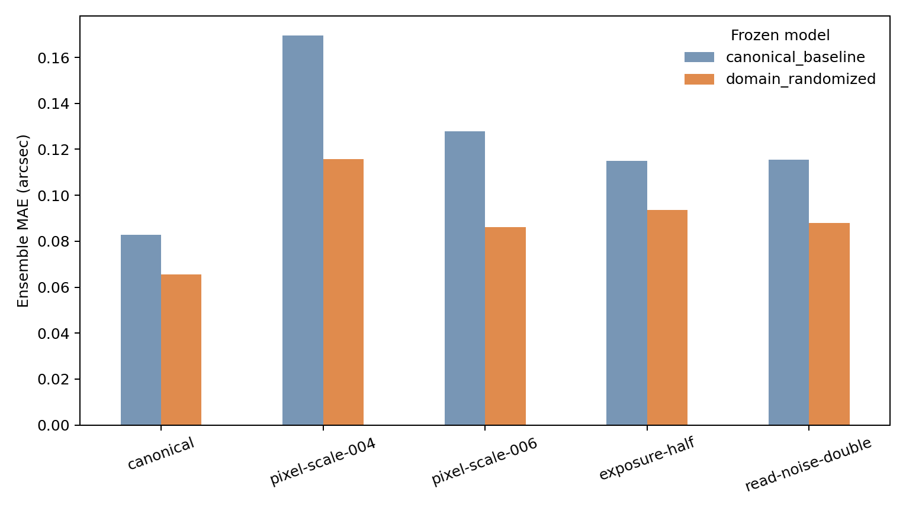

# Week 11 — independent blind synthetic holdout

This is the single target-joined evaluation of 150 new parent systems and 750 observations. The three-seed Week 8 randomized ensemble is the frozen final model; the original canonical-trained ensemble is a fixed comparator.

## Ensemble metrics

| Condition | Randomized MAE | Baseline MAE | Randomized RMSE | Baseline RMSE | Randomized bias | Baseline bias |
|---|---:|---:|---:|---:|---:|---:|
| canonical | 0.0655 | 0.0828 | 0.0942 | 0.1085 | 0.0099 | -0.0063 |
| pixel-scale-004 | 0.1158 | 0.1696 | 0.1531 | 0.2101 | 0.0221 | -0.0288 |
| pixel-scale-006 | 0.0862 | 0.1278 | 0.1125 | 0.1581 | 0.0115 | 0.0213 |
| exposure-half | 0.0936 | 0.1150 | 0.1415 | 0.1552 | -0.0189 | -0.0417 |
| read-noise-double | 0.0879 | 0.1155 | 0.1295 | 0.1572 | -0.0095 | -0.0365 |

Equal-weight four-stress parent-paired MAE change (randomized minus baseline): **-0.0361 arcsec** (95% parent-bootstrap interval [-0.0427, -0.0294]).

The per-checkpoint predictions and seed-averaged predictions were written and hashed before holdout targets were joined. The evaluator joined the new holdout labels once, then wrote the completion marker. No historical test or real-data labels were accessed, and no tuning followed the result.

## Integrity and scope

- Independent parents / observations: **150 / 750**.
- Checkpoints evaluated: **6** across two frozen model groups.
- Prediction files were target-free and hashed before target join: **True**.
- Historical test accessed / real labels accessed / post-holdout tuning: **False / False / False**.
- This is independent synthetic evidence for the tested prior, simulator, preprocessing, and nuisance strata. It does not establish real-domain performance.
- Error counts use the fixed descriptive thresholds |error| > 0.05 arcsec and |error| > 0.10 arcsec.

## Error counts by condition

| Condition | Model | Errors > 0.05 arcsec | Errors > 0.10 arcsec |
|---|---|---:|---:|
| canonical | domain_randomized | 73 | 26 |
| canonical | canonical_baseline | 94 | 49 |
| pixel-scale-004 | domain_randomized | 102 | 67 |
| pixel-scale-004 | canonical_baseline | 123 | 96 |
| pixel-scale-006 | domain_randomized | 92 | 48 |
| pixel-scale-006 | canonical_baseline | 117 | 78 |
| exposure-half | domain_randomized | 81 | 46 |
| exposure-half | canonical_baseline | 102 | 64 |
| read-noise-double | domain_randomized | 82 | 45 |
| read-noise-double | canonical_baseline | 110 | 60 |
