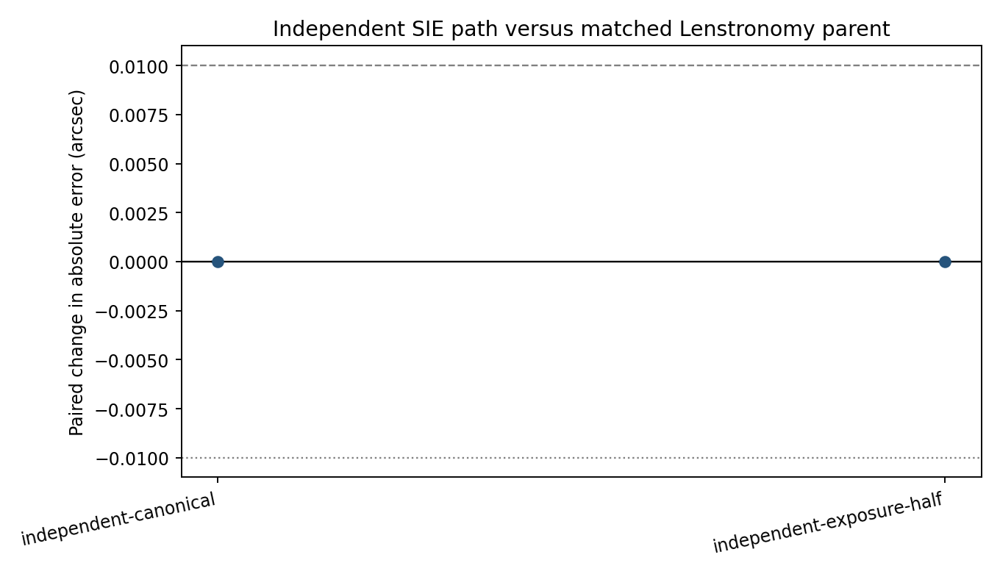

# Week 7 — independent SIE equation comparison

A matched validation-only benchmark using the same 150 parent systems, physical parameters, CNN checkpoints, and noise seeds as the frozen Lenstronomy reference. Predictions were saved before validation targets were joined for scoring.

- Parents per condition: **150**
- Frozen CNN seeds: **12001, 12002, 12003**
- Bootstrap: **10,000** parent resamples, seed **6031**
- Practical-effect margin: **0.010 arcsec**
- Root-count agreement: **150/150**
- Maximum deflection component difference: **7.623e-09 arcsec**
- Maximum matched root separation: **6.366e-09 arcsec**
- Historical synthetic test and real-data labels accessed: **no**

## Paired CNN effects versus Lenstronomy

| Condition | Parents | Paired MAE change (arcsec) | Parent bootstrap 95% interval | Mean absolute prediction shift | Seed-averaged MAE |
|---|---:|---:|---:|---:|---:|
| independent-canonical | 150 | -0.000001 | [-0.000002, +0.000000] | 0.000000 | 0.0874 |
| independent-exposure-half | 150 | -0.000000 | [-0.000001, -0.000000] | 0.000000 | 0.1323 |

The independent implementation matches Lenstronomy's SIE deflection and point-image roots within the frozen tolerances. The four-parent renderer smoke also reproduces the reference clean image, PSF-convolved expected scene, and processed canonical image to floating-point precision. These controls show implementation agreement for the tested SIE proposal.

The scope is limited. Lenstronomy still supplies Sersic surface brightness; the project supplies the Gaussian PSF, detector draw, and preprocessing. This is an equation/root/rasterization comparison, not a second full simulator. Canonical agreement therefore does not establish robustness to different light profiles, PSFs, detectors, or real HST images.

Machine-readable control, root, smoke, image, prediction, and paired-effect records are stored beside this report. `predictions_before_scoring.csv` is the pre-label inference artifact.
