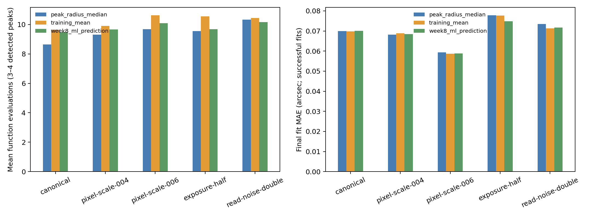

# Week 9 ? hybrid classical/ML initialization

- Validation systems: **150** in each of **5** conditions.
- Fit records: **6750** across three CNN seeds and three starts.
- Three/four-peak parent-condition-seed cases: **594** (198 parent-condition pairs across 150 parents).
- Week 8 randomized checkpoints verified by SHA-256: **3**.
- Fit predictions saved before label join: **True**.
- Historical test and real-data labels accessed: **False / False**.

## Condition metrics

| Condition | Start | Successful-fit MAE (arcsec) | SIE convergence (3+ peaks) | Mean evaluations (3+ peaks) | Mean runtime (s) |
|---|---|---:|---:|---:|---:|
| canonical | training_mean | 0.0698 | 1.000 | 9.64 | 0.0578 |
| canonical | peak_radius_median | 0.0700 | 1.000 | 8.64 | 0.0438 |
| canonical | week8_ml_prediction | 0.0701 | 1.000 | 9.47 | 0.0445 |
| pixel-scale-004 | training_mean | 0.0688 | 1.000 | 9.90 | 0.0491 |
| pixel-scale-004 | peak_radius_median | 0.0681 | 1.000 | 9.31 | 0.0463 |
| pixel-scale-004 | week8_ml_prediction | 0.0685 | 1.000 | 9.67 | 0.0484 |
| pixel-scale-006 | training_mean | 0.0587 | 0.980 | 10.63 | 0.0488 |
| pixel-scale-006 | peak_radius_median | 0.0593 | 0.980 | 9.67 | 0.0457 |
| pixel-scale-006 | week8_ml_prediction | 0.0588 | 0.980 | 10.08 | 0.0483 |
| exposure-half | training_mean | 0.0776 | 1.000 | 10.55 | 0.0518 |
| exposure-half | peak_radius_median | 0.0779 | 1.000 | 9.55 | 0.0481 |
| exposure-half | week8_ml_prediction | 0.0749 | 1.000 | 9.69 | 0.0474 |
| read-noise-double | training_mean | 0.0713 | 1.000 | 10.44 | 0.0476 |
| read-noise-double | peak_radius_median | 0.0734 | 1.000 | 10.32 | 0.0491 |
| read-noise-double | week8_ml_prediction | 0.0718 | 1.000 | 10.16 | 0.0483 |

## Paired initializer effects

| Condition | Comparison | Measure | Mean paired effect | Parent bootstrap 95% interval |
|---|---|---|---:|---:|
| canonical | training_mean vs ML | function_evaluations | 0.1704 | [-0.5111, 0.8519] |
| canonical | training_mean vs ML | runtime_seconds | 0.0133 | [-0.0001, 0.0374] |
| canonical | peak_radius_median vs ML | function_evaluations | -0.8296 | [-1.5778, -0.1924] |
| canonical | peak_radius_median vs ML | runtime_seconds | -0.0006 | [-0.0024, 0.0011] |
| canonical | ML vs training_mean | theta_E_abs_error_arcsec | 0.0006 | [-0.0020, 0.0035] |
| canonical | ML vs peak_radius_median | theta_E_abs_error_arcsec | 0.0002 | [-0.0004, 0.0012] |
| pixel-scale-004 | training_mean vs ML | function_evaluations | 0.2308 | [-0.6325, 1.2051] |
| pixel-scale-004 | training_mean vs ML | runtime_seconds | 0.0007 | [-0.0022, 0.0038] |
| pixel-scale-004 | peak_radius_median vs ML | function_evaluations | -0.3590 | [-1.0427, 0.2906] |
| pixel-scale-004 | peak_radius_median vs ML | runtime_seconds | -0.0020 | [-0.0044, -0.0001] |
| pixel-scale-004 | ML vs training_mean | theta_E_abs_error_arcsec | -0.0008 | [-0.0035, 0.0011] |
| pixel-scale-004 | ML vs peak_radius_median | theta_E_abs_error_arcsec | 0.0009 | [-0.0002, 0.0025] |
| pixel-scale-006 | training_mean vs ML | function_evaluations | 0.5510 | [-0.2041, 1.4422] |
| pixel-scale-006 | training_mean vs ML | runtime_seconds | 0.0004 | [-0.0024, 0.0037] |
| pixel-scale-006 | peak_radius_median vs ML | function_evaluations | -0.4082 | [-1.1769, 0.3333] |
| pixel-scale-006 | peak_radius_median vs ML | runtime_seconds | -0.0026 | [-0.0055, -0.0001] |
| pixel-scale-006 | ML vs training_mean | theta_E_abs_error_arcsec | 0.0002 | [-0.0031, 0.0032] |
| pixel-scale-006 | ML vs peak_radius_median | theta_E_abs_error_arcsec | -0.0011 | [-0.0071, 0.0030] |
| exposure-half | training_mean vs ML | function_evaluations | 0.8602 | [-0.7312, 3.4516] |
| exposure-half | training_mean vs ML | runtime_seconds | 0.0044 | [-0.0020, 0.0152] |
| exposure-half | peak_radius_median vs ML | function_evaluations | -0.1398 | [-0.8925, 0.8280] |
| exposure-half | peak_radius_median vs ML | runtime_seconds | 0.0007 | [-0.0021, 0.0043] |
| exposure-half | ML vs training_mean | theta_E_abs_error_arcsec | -0.0076 | [-0.0226, 0.0000] |
| exposure-half | ML vs peak_radius_median | theta_E_abs_error_arcsec | -0.0082 | [-0.0240, 0.0000] |
| read-noise-double | training_mean vs ML | function_evaluations | 0.2843 | [-0.3431, 0.9510] |
| read-noise-double | training_mean vs ML | runtime_seconds | -0.0006 | [-0.0029, 0.0015] |
| read-noise-double | peak_radius_median vs ML | function_evaluations | 0.1667 | [-0.7353, 1.1569] |
| read-noise-double | peak_radius_median vs ML | runtime_seconds | 0.0009 | [-0.0024, 0.0048] |
| read-noise-double | ML vs training_mean | theta_E_abs_error_arcsec | 0.0012 | [0.0002, 0.0026] |
| read-noise-double | ML vs peak_radius_median | theta_E_abs_error_arcsec | -0.0044 | [-0.0163, 0.0022] |

## Limits

- The classical control is an observation-only SIS/SIE point-image geometry fit, not a full pixel-likelihood fit.
- Two-image cases use a closed-form SIS fit and cannot show optimizer initialization speed differences.
- Speed comparisons use only systems with three or four detected peaks; peak detection is itself observation dependent.
- The fit is a validation development comparison on the tested synthetic conditions, not a blind holdout or real-domain benchmark.

Fit records are written in `hybrid_fit_predictions_before_scoring.csv`; target-joined validation results are in `hybrid_fit_scored_validation.csv`. This phase does not access the historical test split or real-data labels.
