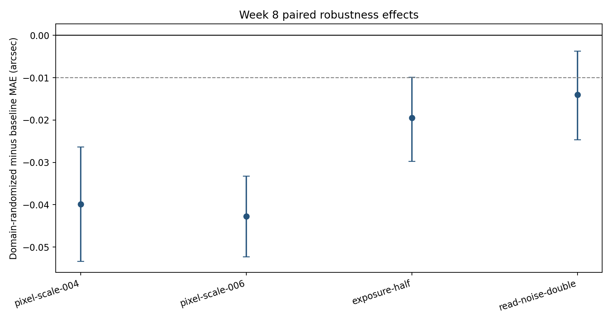

# Week 8 — targeted nuisance randomization

A matched validation comparison of the frozen CNN ensemble and a three-seed CNN retrained with one deterministic nuisance-randomized view for each original training parent. The training release contains 1,400 rows from 700 independent parents.

- Composite stress MAE change: **-0.0290 arcsec** (-0.0351, -0.0231)
- Canonical MAE change: **-0.0109 arcsec** (upper 95% bound -0.0031)
- Stress rule passed: **yes**
- Canonical non-inferiority passed: **yes**
- Historical synthetic test and real-data labels accessed: **no**

## Paired condition effects

| Condition | Paired MAE change (arcsec) | Parent bootstrap 95% interval | Mean absolute prediction shift |
|---|---:|---:|---:|
| canonical | -0.0109 | [-0.0189, -0.0031] | 0.0464 |
| pixel-scale-004 | -0.0398 | [-0.0533, -0.0263] | 0.0875 |
| pixel-scale-006 | -0.0427 | [-0.0523, -0.0332] | 0.0683 |
| exposure-half | -0.0195 | [-0.0297, -0.0099] | 0.0591 |
| read-noise-double | -0.0140 | [-0.0247, -0.0037] | 0.0610 |

The randomized view draws pixel scale from 0.04/0.05/0.06 arcsec per pixel, exposure multiplier from 0.5/1.0, and read-noise multiplier from 1/2 using seed 6031. The original canonical training view remains in the training set. The randomized sample is an augmentation of the same parent, not a new independent lens system.

The study only supports claims about these synthetic nuisance ranges and the frozen CNN. A pass does not establish simulation-to-real transfer. If the overall rule failed, the protocol permits one scale-metadata diagnostic; no other architecture search is allowed.
