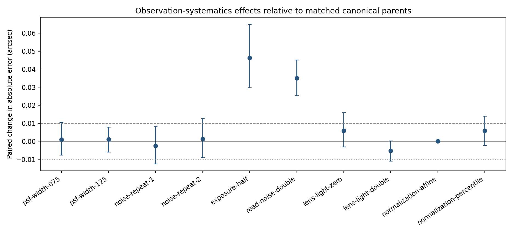

# Week 4 — PSF and observation-systematics audit

Validation-only matched evaluation of the three frozen CNN seeds. All conditions share the same 150 H1 validation parents; repeated noise realizations are clustered by parent.

- Independent validation parents: **150**
- Frozen CNN seeds: **3**
- Conditions including canonical: **11**
- Practical-effect threshold: **0.010 arcsec**
- Historical synthetic test split accessed: **no**
- Alternate PSF family: **not available in the validated renderer; width-only comparison**
- The integrated-scene SNR is a simulator-defined diagnostic, not calibrated astronomical SNR.

## Paired CNN effects

| Condition | Parents | Paired MAE change (arcsec) | Parent-bootstrap 95% interval | Practical increase supported | Practically small |
|---|---:|---:|---:|:---:|:---:|
| psf-width-075 | 150 | +0.0009 | [-0.0077, +0.0104] | no | no |
| psf-width-125 | 150 | +0.0011 | [-0.0060, +0.0079] | no | yes |
| noise-repeat-1 | 150 | -0.0025 | [-0.0125, +0.0083] | no | no |
| noise-repeat-2 | 150 | +0.0013 | [-0.0090, +0.0126] | no | no |
| exposure-half | 150 | +0.0463 | [+0.0297, +0.0649] | yes | no |
| read-noise-double | 150 | +0.0350 | [+0.0254, +0.0451] | yes | no |
| lens-light-zero | 150 | +0.0058 | [-0.0032, +0.0159] | no | no |
| lens-light-double | 150 | -0.0052 | [-0.0111, +0.0002] | no | no |
| normalization-affine | 150 | +0.0000 | [-0.0000, +0.0000] | no | yes |
| normalization-percentile | 150 | +0.0059 | [-0.0023, +0.0139] | no | no |

The parent bootstrap averages seed-specific paired effects within parent first. `cnn_metrics_per_seed.csv` keeps optimization-seed variation separate. Full per-parent predictions, radius-bin metrics, multiplicity counts, and the simulator SNR proxy are preserved alongside this report.

PSF-family differences were not tested because the validated renderer supplies only a Gaussian control. Detector noise and variance are simulator abstractions and do not establish calibrated instrument-domain performance. Source-position/detectability interventions remain ordered for Week 5.
