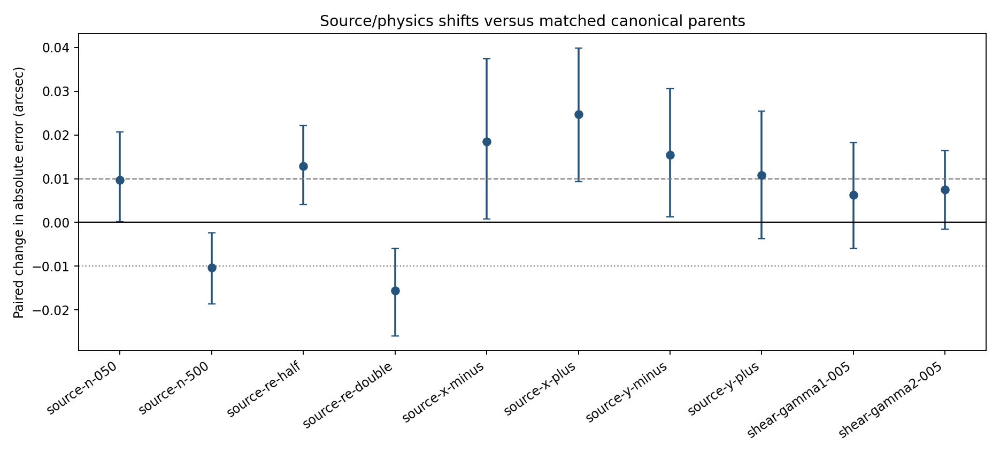
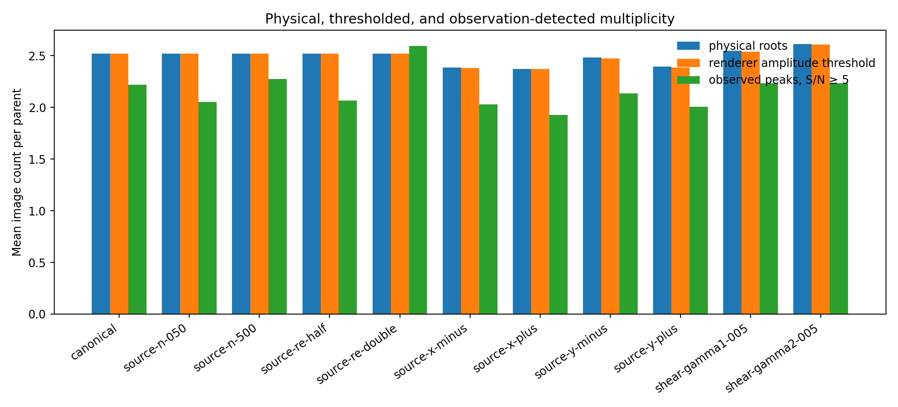

# Week 5 — Source and physics mismatch audit

Validation-only matched evaluation on the same 150 parents as Weeks 3–4. Three frozen CNN seeds, paired parent bootstrap, and the v1.3 observation-only peak detector were used. The historical test split was not accessed.

## Paired CNN effects

| Intervention | Parents | Paired MAE change (arcsec) | 95% parent interval | Supported >=0.01 | Practically small |
|---|---:|---:|---:|:---:|:---:|
| source-n-050 | 150 | +0.0097 | [+0.0002, +0.0207] | no | no |
| source-n-500 | 150 | -0.0103 | [-0.0186, -0.0024] | no | no |
| source-re-half | 150 | +0.0129 | [+0.0041, +0.0222] | yes | no |
| source-re-double | 150 | -0.0156 | [-0.0260, -0.0059] | no | no |
| source-x-minus | 150 | +0.0185 | [+0.0008, +0.0374] | yes | no |
| source-x-plus | 150 | +0.0248 | [+0.0093, +0.0398] | yes | no |
| source-y-minus | 150 | +0.0155 | [+0.0013, +0.0306] | yes | no |
| source-y-plus | 150 | +0.0108 | [-0.0038, +0.0255] | no | no |
| shear-gamma1-005 | 150 | +0.0063 | [-0.0059, +0.0183] | no | no |
| shear-gamma2-005 | 150 | +0.0075 | [-0.0015, +0.0164] | no | no |

## Multiplicity interpretation

Physical multiplicity is the renderer's point-source image-root count. The renderer's 0.05-amplitude threshold is a simulator diagnostic. The observation-detected count is a separate PSF-matched peak count at S/N ≥ 5 using observed products only. These quantities are preserved parent-by-parent and are not interchangeable.

## Failure-mechanism ranking

`failure_mechanism_ranking.csv` joins Week 3 pixel-scale, Week 4 observation-systematics, and Week 5 source/physics paired effects. It sorts supported positive penalties first, then remaining positive mean effects. This across-condition ranking is descriptive; its intervals are unadjusted for the number of conditions.

## Limits

The validated simulator uses one elliptical Sersic source family and SIE, optionally with external shear. No alternative source or mass family was available for a validated comparison. The source-index/radius controls and fixed 0.05 shear are synthetic stress conditions, not a calibrated population prior. The classical control remains point-image geometry with fallback.
